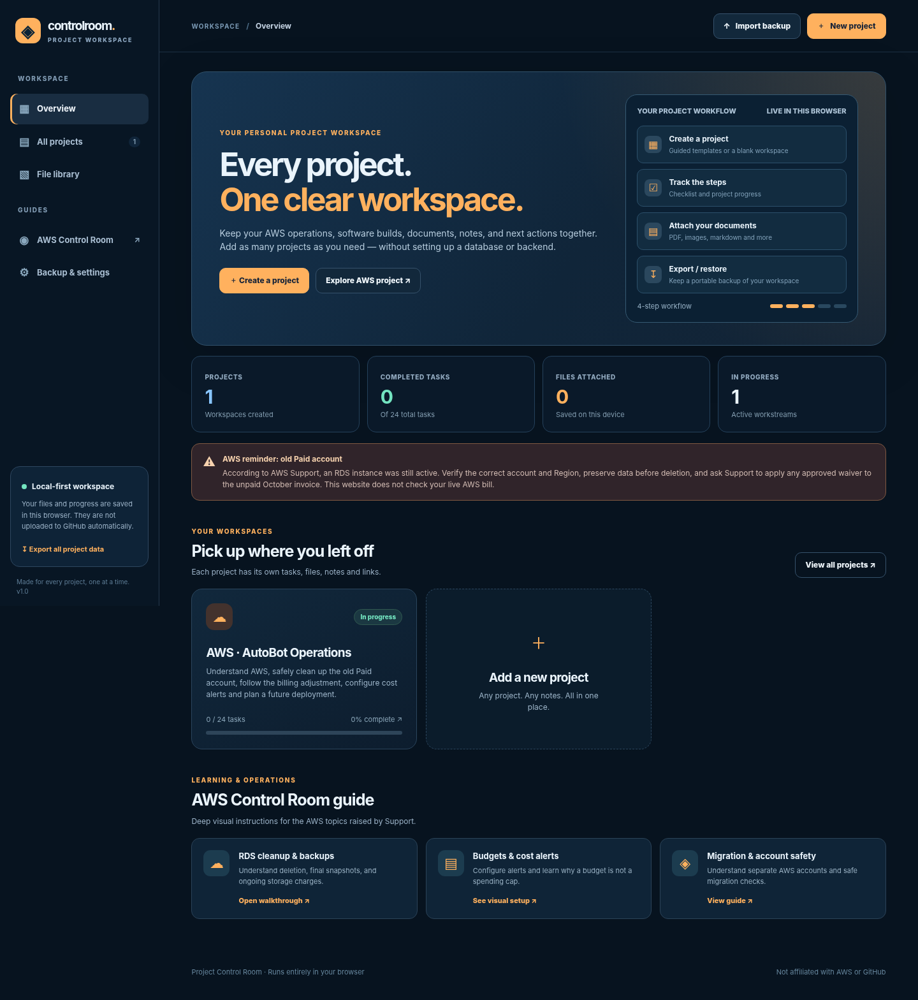

# Project Control Room

A visual, local-first website for organizing **any project** in one place: checklists, attachments, working notes, helpful links, and a built-in AWS operations playbook.

No backend, login, npm installation, AWS account, or API key required. Designed to work on GitHub Pages.



## Get started in one minute

1. Extract the ZIP.
2. Open `index.html` in your browser. For consistent uploaded-file storage, serve it using a local web server instead (recommended):

   ```bash
   cd project-control-room
   python3 -m http.server 8000
   ```

3. Visit `http://localhost:8000`.
4. Open **AWS · AutoBot Operations** or click **New project** to add your own.

## What you can do

- Create AWS, software, learning/research, or blank projects.
- Add and check off project tasks, split into custom groups/phases.
- Add project files, including images, PDFs, code, Office documents, Markdown and ZIP files (up to 12 MB each).
- Preview images, PDFs, Markdown/text, JSON, and CSV files; download others.
- Keep local project notes and useful HTTPS links.
- Export **all projects and attachments** to a portable JSON backup; restore it on another browser or device.
- Read the AWS Control Room guide with documentation links, visual diagrams, checklists, and cost-safety concepts.

## GitHub Pages deployment (no build step)

1. Create a **new repository** at https://github.com/new. Suggested name: `project-control-room`. **Do not use your live application's repo.**
2. Upload the **contents of this folder**, so `index.html` is at the repository root. Alternatively push via Git:

   ```bash
   git init
   git add .
   git commit -m "Initial visual project workspace"
   git branch -M main
   git remote add origin https://github.com/YOUR-USERNAME/project-control-room.git
   git push -u origin main
   ```

3. Open your repo **Settings → Pages → Build and deployment**.
4. Choose **Deploy from a branch** → `main` → `/(root)` → **Save**.
5. Your site will typically appear at `https://YOUR-USERNAME.github.io/project-control-room/` after GitHub finishes publishing. GitHub Pages may take a few minutes to build.

Official GitHub documentation: https://docs.github.com/en/pages/getting-started-with-github-pages/configuring-a-publishing-source-for-your-github-pages-site

## Privacy, security and limits

**This is a static, browser-only application.** Project data stays locally on the device in which you opened it:

- Project metadata/tasks/notes/links: browser **localStorage**.
- Uploaded file blobs: browser **IndexedDB**.
- Export creates a JSON file containing the saved files as base64 attachments.
- Nothing is uploaded automatically to GitHub, AWS, or a server.
- Browser data may disappear when you clear site data or use private browsing. **Export backups frequently.**
- Data does **not sync** between your phone/laptop. Move a full backup between devices to restore.
- There is **no multi-user login, roles, online file storage, or live AWS integration**.
- GitHub Pages websites are public, including when hosted from private source repos in supported plans. Never commit passwords, AWS keys, account numbers, invoices, `.env`, or sensitive correspondence to your repository.
- The included AWS guide is a privacy-sanitized sample. It never accesses your AWS account. Confirm important actions in the live AWS console. Make a verified database backup before terminating RDS.

For collaboration, account-based storage, or syncing files automatically, a separate authenticated backend and storage service are required.

## Files

- `index.html` — Main dashboard and dialogs.
- `styles.css` — Responsive styling.
- `app.js` — Local persistence, project management, tasks, file uploads and backup import/export.
- `guides/aws.html` — Static detailed AWS operations playbook, with separate local checklist storage.
- `assets/icon.svg` — Site icon.

## Updating this website

All the functionality is implemented in standard HTML/CSS/JavaScript; there is **no React build step**. Update the files and push to `main`. GitHub Pages publishes the updated source.

## Disclaimer

This is an independent educational workspace, not an AWS tool. A checklist cannot confirm that AWS resources have stopped accruing charges. Verify in AWS Billing/Cost Explorer and with Support.
